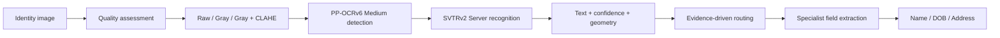

# Identity Document OCR — COMPFEST 18

**Ekstraksi Name, Date of Birth, dan Address dari dokumen identitas yang heterogen.**

Final Project **Data Science Academy COMPFEST 18**, tim **Ketolak Pacil**: Orie Abyan Maulana, Aditya Akbar, dan Khansa Firyal Adiila. Nama anggota mengikuti presentasi final; notebook asal menyingkat nama Khansa.

**Arsip lengkap:** [seluruh original project](original_project/), termasuk dataset, PDF, executed notebooks, frozen outputs, dan nested ZIPs. [Release `archive-v1`](https://github.com/maulnite/identity-document-ocr-compfest18/releases/tag/archive-v1) menyediakan ZIP utama asli serta snapshot hasil reproduksi lokal. Lihat [panduan backup dan pemulihan](docs/BACKUP.md).

**Notebook dengan output:** [Final project](notebooks/01_final_project.ipynb) · [Pipeline-driven EDA](notebooks/02_pipeline_driven_eda.ipynb) · [OCR identity ablation](notebooks/03_ocr_identity_ablation.ipynb). Final notebook dijalankan ulang saat verifikasi; EDA/ablation menampilkan retained outputs asal dengan provenance dijelaskan dalam [Notebook guide](docs/NOTEBOOKS.md).

Proyek ini menggabungkan quality-aware preprocessing, hybrid OCR, evidence-driven routing, dan specialist field extraction untuk mendukung pengisian data identitas dalam workflow KYC. Repository mendokumentasikan metodologi, perjalanan eksperimen V3–V28, dan hasil akhir beserta batas interpretasinya.

> **Ruang lingkup hasil:** V28 adalah downstream benchmark pada **632 labeled images**, menggunakan known label-derived identity groups untuk peer analysis. Angka ini belum mengukur generalisasi pada identitas baru. Reproduksi yang tersedia menggunakan frozen OCR artifacts; model weights dan runtime untuk full raw-image OCR tidak disertakan.

## Hasil utama

| Metrik | V27 | V28 |
|---|---:|---:|
| Name Exact Match | 46,20% | 46,20% |
| DOB Exact Match | 69,62% | **70,41%** |
| Address Exact Match, seluruh labeled rows | 83,70% | 83,70% |
| Macro Field Exact Match | 66,51% | **66,77%** |
| Full Record Exact Match | 37,66% | 37,66% |
| Normalized Edit Similarity | 79,70% | **81,28%** |
| Record CER ↓ | 1,3581 | **1,3495** |

Address all-row EM dipengaruhi **520 blank labels**. Pada **112 address-present rows**, Address EM hanya **25,00%**. CER dapat lebih besar dari 1 karena insertion errors dan pembagian terhadap panjang ground truth. Detail formula dan sumber angka: [Evaluation](docs/EVALUATION.md) serta [aggregate artifacts](results/aggregate/).


## Pipeline



Repeated-capture linking dan downstream peer consensus dijelaskan sebagai development/evaluation layer terpisah. V3 memiliki implementasi Siamese linker; peer grouping V18–V28 menggunakan known label-derived groups dan tidak membuktikan bahwa predicted clusters siap untuk deployment.

## Dataset dan temuan

- **732 images**: 632 labeled dan 100 test images tanpa ground truth dalam arsip.
- **152 label-derived groups** pada labeled set; 26 repeated groups mencakup 506 images.
- Coarse families: 100 MyKad, 182 MRZ documents, dan 350 Generic ID pada labeled set.
- Generic ID mendapat secondary country/layout routing; **147 images** tetap Unknown Route.
- Name EM pada Unknown Route masih **0%**, sehingga perlu perbaikan routing dan recognition.

[Dataset audit](docs/DATASET.md) membahas format CSV, raw spreadsheet, dan definisi identity group.

## Mulai membaca

| Tujuan | Dokumentasi |
|---|---|
| Memahami masalah dan keputusan bisnis | [Project overview](docs/PROJECT_OVERVIEW.md) |
| Memahami seluruh isi arsip | [Archive guide](docs/ARCHIVE_GUIDE.md) |
| Memahami preprocessing, routing, dan extraction | [Architecture](docs/ARCHITECTURE.md) |
| Menelusuri eksperimen V3–V28 | [Experiments](docs/EXPERIMENTS.md) |
| Memahami metrik dan validation limitations | [Evaluation](docs/EVALUATION.md) |
| Menjalankan reproduksi lokal | [Reproducibility](docs/REPRODUCIBILITY.md) |
| Menjalankan dan membandingkan notebook | [Notebook guide](docs/NOTEBOOKS.md) |
| Memahami apa yang dipublikasikan | [Publication notes](docs/PUBLICATION.md) |
| Mengunduh dan memulihkan arsip lengkap | [Backup dan pemulihan](docs/BACKUP.md) |

## Quick start

Python **3.10** telah digunakan untuk verifikasi lokal. Dependency downstream dipin sesuai bundle asal. Jalankan dari root repository:

```bash
python -m venv .venv
source .venv/bin/activate
python -m pip install -r pipeline/requirements.txt
```

Seluruh original inputs sudah tersedia di `original_project/`. Setelah clone lengkap:

```bash
python tools/prepare_private_artifacts.py
python pipeline/run_v27.py
python pipeline/run_v28.py
python tools/verify_artifacts.py
```

Tidak diperlukan folder sumber lain di server. Helper menyiapkan working copies dari `original_project/`. Final notebook mempunyai jalur reproduksi artifact analysis tersendiri, dijelaskan dalam [Notebook guide](docs/NOTEBOOKS.md).

## Struktur repository

```text
docs/                  Dokumentasi, inventory arsip, dan source provenance
notebooks/             Notebook final yang diverifikasi dan retained EDA/ablation outputs
original_project/      Semua 896 file original, byte-identical dengan hasil ekstraksi
pipeline/              Original source V3–V28, historical phases, dan portable core
results/aggregate/     Metrik serta validation summaries tanpa per-person records
tools/                 Persiapan working artifacts, verifikasi arsip, dan metrik
data/private/          Working copies hasil preparation/run; diabaikan Git
```

Kode historis dipertahankan untuk penelusuran. Sebagian memerlukan assets atau full core yang tidak ada dalam bundle portable; hanya downstream V24–V28 dan final artifact notebook yang menjadi jalur reproduksi ringan. Lihat [hasil verifikasi lokal](docs/VERIFICATION.md).

## Kontribusi dan penggunaan

Repository disusun dari materi proyek tim. Belum ada lisensi redistribusi eksplisit pada arsip yang diperiksa; tidak ditambahkan lisensi baru atas nama tim. Dataset, slide, logo, dan third-party model assets tetap mengikuti izin masing-masing pemilik. Perbaikan selanjutnya diprioritaskan pada Unknown Route Name extraction, validasi pada unseen identities, serta confidence calibration untuk human review.
