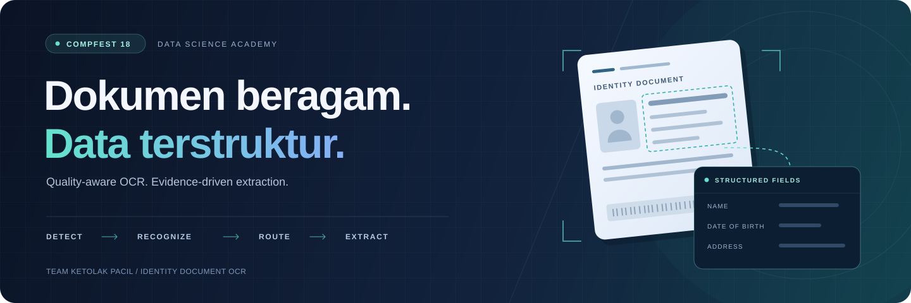
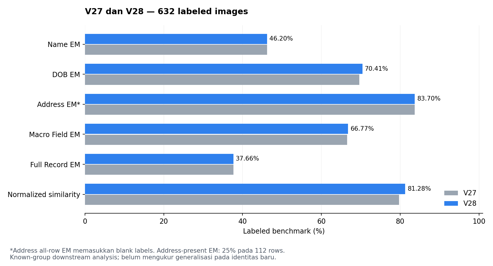

<p align="center">
  
</p>

<h1 align="center">Identity Document OCR</h1>

<p align="center">
  Ekstraksi <strong>Name</strong>, <strong>Date of Birth</strong>, dan <strong>Address</strong><br />
  dari dokumen identitas yang heterogen untuk mendukung workflow KYC.
</p>

<p align="center">
  <a href="docs/PROJECT_OVERVIEW.md"></a>
  <a href="docs/REPRODUCIBILITY.md"></a>
  <a href="docs/EVALUATION.md"></a>
  <a href="docs/BACKUP.md"></a>
</p>

<p align="center">
  <a href="#hasil-benchmark">Hasil</a> ·
  <a href="#cara-kerjanya">Pipeline</a> ·
  <a href="#notebook">Notebook</a> ·
  <a href="#dokumentasi">Dokumentasi</a> ·
  <a href="#quick-start">Quick start</a> ·
  <a href="#arsip-lengkap">Arsip &amp; backup</a>
</p>

---

Final Project **Data Science Academy COMPFEST 18** oleh tim **Ketolak Pacil**. Proyek ini menggabungkan quality-aware preprocessing, hybrid OCR, evidence-driven routing, dan specialist field extraction. Repository memuat perjalanan eksperimen **V3–V28**, notebook dengan output, serta arsip proyek lengkap yang telah diuji pemulihannya dari GitHub.

## Hasil benchmark

<table>
  <tr>
    <td align="center" width="300">
      <sub>MACRO FIELD EXACT MATCH</sub>
      <h2>66,77%</h2>
      <sub>V28 · Name, DOB, Address</sub>
    </td>
    <td align="center" width="300">
      <sub>NORMALIZED EDIT SIMILARITY</sub>
      <h2>81,28%</h2>
      <sub>V28 · character fidelity</sub>
    </td>
    <td align="center" width="300">
      <sub>FULL RECORD EXACT MATCH</sub>
      <h2>37,66%</h2>
      <sub>V28 · ketiga field benar sekaligus</sub>
    </td>
  </tr>
</table>

> **Konteks evaluasi:** hasil ini adalah downstream benchmark pada **632 labeled images**, menggunakan known label-derived identity groups untuk peer analysis. Generalisasi pada identitas baru belum diukur. Reproduksi memakai frozen OCR artifacts; full raw-image OCR membutuhkan assets tambahan yang tidak ada dalam arsip sumber.



<details>
<summary><strong>Lihat perbandingan lengkap V27 → V28</strong></summary>

| Metrik | V27 | V28 |
|---|---:|---:|
| Name Exact Match | 46,20% | 46,20% |
| DOB Exact Match | 69,62% | **70,41%** |
| Address Exact Match, seluruh labeled rows | 83,70% | 83,70% |
| Macro Field Exact Match | 66,51% | **66,77%** |
| Full Record Exact Match | 37,66% | 37,66% |
| Normalized Edit Similarity | 79,70% | **81,28%** |
| Record CER ↓ | 1,3581 | **1,3495** |

**Address caveat:** all-row EM mencakup **520 blank labels**. Pada **112 address-present rows**, Address EM adalah **25,00%**. CER dapat lebih besar dari 1 karena insertion errors dan pembagian terhadap panjang ground truth.

[Formula, validation scopes, dan batas interpretasi →](docs/EVALUATION.md) · [Aggregate results →](results/aggregate/)

</details>

## Cara kerjanya


| Quality-aware input | Hybrid OCR | Specialist extraction |
|---|---|---|
| Memilih representasi input berdasarkan kondisi capture. | PP-OCRv6 mendeteksi teks; SVTRv2 mengenali text crops. | OCR text, confidence, geometry, dan layout cues menentukan route serta field logic. |

Dataset mencakup **732 images**: **632 labeled** dan **100 test images**. Pada labeled set terdapat **152 label-derived groups**, dengan 506 images dalam 26 repeated groups. Coarse routing membedakan MyKad, MRZ documents, dan Generic ID sebelum secondary country/layout routing.

**Remaining bottleneck:** 147 labeled images tetap berada pada Unknown Route, dengan Name EM **0%**. Pengembangan berikutnya diprioritaskan pada routing/layout coverage dan recognition untuk kasus tersebut.

Repeated-capture linking dan peer consensus memiliki evaluation scope terpisah. V3 mengeksplorasi Siamese linker; peer analysis V18–V28 menggunakan known label-derived groups. [Baca architecture →](docs/ARCHITECTURE.md)

## Notebook

| Notebook | Isi | Status output |
|---|---|---|
| **[01 · Final project](notebooks/01_final_project.ipynb)** | Business problem → EDA → pipeline → evaluation → rekomendasi | **58 code cells dijalankan ulang dan lolos** |
| **[02 · Pipeline-driven EDA](notebooks/02_pipeline_driven_eda.ipynb)** | Image quality, document routes, repeated captures, dan design evidence | Retained outputs dari notebook asal |
| **[03 · OCR identity ablation](notebooks/03_ocr_identity_ablation.ipynb)** | Hybrid OCR vs PP-OCRv6 end-to-end pada identity-pair diagnostics | Retained analytical outputs dari notebook asal |

EDA dan GPU ablation belum dijalankan ulang setelah penyesuaian source. Original notebooks, termasuk embedded evidence dan seluruh original outputs, tersimpan utuh di [`original_project/`](original_project/). [Panduan dan provenance notebook →](docs/NOTEBOOKS.md)

## Dokumentasi

| Mulai dari sini | Lanjutkan ke |
|---|---|
| [Project overview](docs/PROJECT_OVERVIEW.md) — masalah dan tujuan bisnis | [Dataset audit](docs/DATASET.md) — schema, quality, dan grouping |
| [Architecture](docs/ARCHITECTURE.md) — preprocessing hingga structured fields | [Experiments](docs/EXPERIMENTS.md) — perjalanan V3–V28 dan ablation |
| [Evaluation](docs/EVALUATION.md) — formula, hasil, dan validation limitations | [Verification](docs/VERIFICATION.md) — pemeriksaan yang benar-benar dijalankan |
| [Reproducibility](docs/REPRODUCIBILITY.md) — environment dan langkah re-run | [Notebook guide](docs/NOTEBOOKS.md) — urutan baca serta perubahan source |
| [Archive guide](docs/ARCHIVE_GUIDE.md) — seluruh isi arsip sumber | [Backup & recovery](docs/BACKUP.md) — download, checksum, dan pemulihan |

## Quick start

Reproduksi downstream **V27/V28** menggunakan Python **3.10** dan frozen inputs yang sudah disertakan dalam repository.

```bash
git clone https://github.com/maulnite/identity-document-ocr-compfest18.git
cd identity-document-ocr-compfest18

python -m venv .venv
source .venv/bin/activate
python -m pip install -r pipeline/requirements.txt

python tools/prepare_private_artifacts.py
python pipeline/run_v27.py
python pipeline/run_v28.py
python tools/verify_artifacts.py
```

Hasil yang diharapkan pada verification: **`"verification": "passed"`**. Helper memakai `original_project/` untuk menyiapkan working copies; tidak memerlukan folder sumber di server lama.

<details>
<summary><strong>Jalankan notebook final</strong></summary>

Setelah environment dan frozen inputs siap:

```bash
python -m pip install -r requirements-notebooks.txt
python tools/run_final_notebook.py
```

Execution copy disimpan di `data/private/final_project_executed.ipynb`. Folder tersebut adalah working area yang dapat dibangun ulang dari original inputs dalam repository.

</details>

## Arsip lengkap

**896 original files** telah dipertahankan byte-identical, termasuk dataset, PDF, notebook, frozen outputs, serta nested ZIPs. Master ZIP asli dan snapshot hasil reproduksi tersedia melalui **[Release `archive-v1`](https://github.com/maulnite/identity-document-ocr-compfest18/releases/tag/archive-v1)**.

| Akses materi | Verifikasi |
|---|---|
| [Telusuri seluruh original project](original_project/) | [File inventory & SHA-256](docs/archive_inventory.csv) |
| [Unduh master ZIP dan reproduction snapshot](https://github.com/maulnite/identity-document-ocr-compfest18/releases/tag/archive-v1) | [Release checksums](docs/release_checksums.sha256) |
| [Panduan backup dan pemulihan](docs/BACKUP.md) | [Fresh-clone recovery report](docs/backup_verification.json) |

Pemulihan telah diuji dari clone baru GitHub: original hashes cocok, V27/V28 dapat direproduksi, dan notebook final berhasil dijalankan. Kedua ZIP Release juga telah diunduh ulang dan diverifikasi. [Publication notes →](docs/PUBLICATION.md)

<details>
<summary><strong>Struktur repository</strong></summary>

```text
identity-document-ocr-compfest18/
├── docs/                 Dokumentasi, visual, inventory, dan verification reports
├── notebooks/            Executed final notebook dan retained EDA/ablation outputs
├── original_project/     Seluruh 896 original files
├── pipeline/             Source V3–V28 dan portable downstream core
├── results/aggregate/    Metric serta validation summaries
├── tools/                Artifact preparation dan verification
└── data/private/         Working copies hasil preparation/run; diabaikan Git
```

Historical source dipertahankan untuk penelusuran. Sebagian scripts membutuhkan full development core atau assets yang tidak tersedia dalam bundle portable. [Scope reproduksi →](docs/REPRODUCIBILITY.md)

</details>

---

<p align="center">
  <strong>Tim Ketolak Pacil</strong><br />
  Orie Abyan Maulana · Aditya Akbar · Khansa Firyal Adiila<br />
  <sub>Data Science Academy · COMPFEST 18</sub>
</p>

Nama anggota mengikuti presentasi final. Arsip sumber belum memuat explicit project license; repository tidak menambahkan lisensi baru atas nama tim. Dataset, slide, dan third-party assets tetap mengikuti hak penggunaan masing-masing pemilik.
