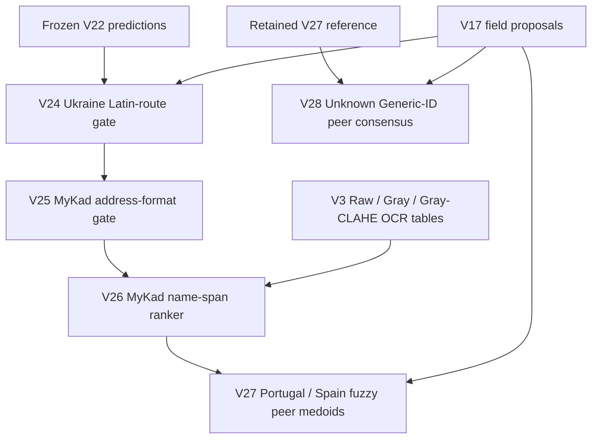

# Architecture

## 1. Quality assessment dan preprocessing

Development pipeline melakukan localization/rectification untuk menghasilkan card view. Final downstream bundle menyimpan geometry dan OCR results; ia tidak menyediakan ulang seluruh localization implementation atau cache.

Tiga OCR input representations adalah `raw`, `gray`, dan `gray_clahe`. Quality-aware selection mempertahankan original detail ketika enhancement tidak diperlukan dan memakai contrast enhancement untuk capture tertentu. Kebijakan final dapat ditinjau pada retained `selected_preprocessing_method` dan `quality_group` metadata.

Policy labels di notebook/presentasi bersifat deskriptif terhadap development artifacts. Jangan menganggap mereka universal preprocessing thresholds untuk dataset lain.

## 2. Hybrid OCR

Implementation V3 mendefinisikan `PPOCRSVTRv2Server`:

- **Text detector:** PP-OCRv6 Medium melalui RapidOCR/ONNX, dijalankan pada CPU.
- **Text recognizer:** OpenOCR SVTRv2 Server melalui PyTorch CUDA.
- **Evidence:** recognized text, per-line confidence, bounding boxes, dan latency metadata.

Komentar development menjelaskan bahwa detector dipindahkan ke CPU setelah mixed ONNX/PyTorch CUDA menimbulkan illegal-memory-access pada workspace A100. Ini alasan engineering pada host asal; tidak membuktikan konfigurasi itu optimal pada semua hardware.

Beberapa filenames historis masih menyebut `ppocrv5`, tetapi docstring dan model constants menyatakan PP-OCRv6. Penamaan file dipertahankan agar imports dan source provenance tetap cocok.

## 3. Evidence-driven routing

Coarse routing membedakan MyKad, MRZ document, dan Generic ID. Secondary routing menggunakan OCR text, layout/numbering, MRZ patterns, serta country-specific cues untuk menentukan specialist.

| Route | Specialist logic |
|---|---|
| MyKad | Name spans, DOB dari ID number, address line reconstruction |
| MRZ / Passport | ICAO-style MRZ evidence dan date interpretation |
| EU Driving Licence | Numbered-field interpretation |
| Ukraine Passport | Pemilihan Latin transliteration |
| HK Mainland Permit, Turkey, Czech, Chile, Spain, Portugal | Template-specific field proposals dan guarded refinements |
| Unknown Route | Conservative generic fallback |

V17 `parse_generic_template()` menyimpan banyak specialist rules. V17 proposal routes juga digunakan untuk route-level error analysis; belum ada independent route-classification benchmark dalam repository.

## 4. Field extraction dan final downstream chain

Penting: **`run_v28.py` membaca retained V27 reference**, bukan output baru dari `run_v27.py`. Kedua jalur sengaja diverifikasi terpisah terhadap artifacts sumber.

### V24

Menggunakan V17 specialist proposals dan peer consensus pada Ukraine Latin names, lalu menerapkan route-specific validation gate.

### V25

Memperbaiki separator awal address MyKad, misalnya `NO.12` menjadi `NO 12`. Perbaikan membatasi perubahan format tanpa mengganti OCR alphanumeric characters.

### V26

Membangun kandidat span satu atau dua OCR lines. RandomForest ranker memakai geometry, text shape, OCR confidence, dan relative position terhadap ID-number line. Ground truth dipakai untuk supervised candidate scoring/training, bukan sebagai inference feature. Group-disjoint holdout dipakai pada component selection.

### V27

Portugal/Spain Name diperbaiki melalui fuzzy medoid pada peer predictions. Target capture dikeluarkan dari peer set. Calibration dan validation mengecek similarity improvement/non-regression; hasilnya menaikkan character similarity tanpa mengubah global Name EM.

### V28

Scope hanya Generic ID tanpa V17 route. Name memerlukan minimal dua non-empty peers; DOB minimal tiga valid peers. Address tidak diubah. Calibration improvement dan holdout non-regression dibutuhkan sebelum candidate release.

Grouping V28 mengambil `identity_group` dari retained table. Walaupun historical report menyebut “visual identity groups”, final notebook menegaskan bahwa downstream analysis memakai known label-derived groups. Tidak ada bukti bahwa stage ini menggunakan Siamese-predicted groups pada unseen identities.

## 5. Development identity linker

V3 representation:

`OCR text + predicted fields → character TF-IDF (2–5 grams) → SVD ≤96D + standardized numeric/family features → Siamese encoder 256→128→64 → cosine similarity`

Training memakai positive pairs dan OCR-similar hard negatives. Threshold diarahkan pada precision target 0,985, disertai DOB/name compatibility checks dan conservative complete-linkage clustering. Ini implementasi development; target precision bukan jaminan metrik final yang tercapai.

V4 mengeksplorasi DINOv2 visual embeddings; V5 mengeksplorasi YOLO-face + ArcFace evidence. Keduanya dicatat sebagai experiments, tanpa mengasumsikan peningkatan karena historical output lengkap tidak tersedia.

## 6. Traceability dan operational boundary

Artifacts menghubungkan per-field result dengan image geometry, OCR evidence, preprocessing, dan route metadata. Traceability tidak sama dengan interpretasi semua internal neural representations.

Portable `identity_ocr_compfest18.py` adalah **minimal compatibility core**: fungsi raw OCR dan recognizer sengaja melempar runtime error. `run_v27.py` memasang minimal `torch`/`cv2` stubs agar historical dependency definitions dapat di-import tanpa menjalankan GPU classes. Jangan menggunakan core ini sebagai image-inference API.
